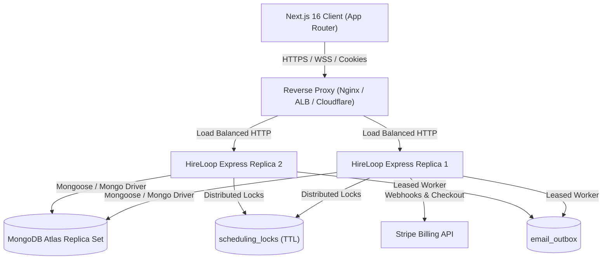

# HireLoop — Staging Deployment & Production Operations Runbook

## 1. System Architecture & Intended Staging Topology

HireLoop operates a decoupled full-stack architecture designed for high availability, zero-trust authorization, and restart resilience.

- **Frontend (`hireloop-client`)**: Next.js 16 (App Router with Turbopack), React 19, Tailwind CSS. Consumes the backend API with credentials and Bearer token fallback.
- **Backend (`hireloop-server`)**: Node.js & Express API with MongoDB persistence, distributed atomic locks, in-process unified scheduler, and transactional email outbox.
- **Data Tier**: MongoDB (Atlas Replica Set recommended). Provides atomic multi-document operations and TTL eviction.
- **Billing**: Stripe Checkout and webhook lifecycle integration.
- **Real-Time Communication**: Server-Sent Events (SSE) stream for notification delivery and candidate messaging.

### Intended Staging Topology
- **API Server Replicas**: Backend is stateless regarding HTTP requests and can safely run across 1 to N replicas behind a reverse proxy/load balancer (e.g. AWS ALB, Nginx, Fly.io, Cloudflare).
- **Background Scheduler & Outbox Worker**:
  - The scheduler runs within the Express process (`startScheduler()`), executing every 30 seconds.
  - Background workers utilize **atomic document leasing** (`status: "processing"`, `lockedBy: WORKER_ID`, `lockedAt: new Date()`) with automatic 5-minute lease timeout recovery. Multiple replicas can safely execute concurrently without duplicate delivery.
  - When running in auto-scaling environments that scale to zero when idle (e.g. AWS Lambda / Cloud Run), run a dedicated container for background workers or utilize a cron ping to keep the scheduler active.
- **Reverse Proxy**: Express is configured with `app.set("trust proxy", 1)` to correctly parse `req.ip` from `X-Forwarded-For` for sliding-window rate limiting.



---

## 2. Environment Configuration & Secrets Management

Separate `.env` files must be maintained for Development, Staging, and Production. **Never commit actual `.env` files or secrets to source control.**

### `hireloop-client` Environment Variables
| Variable | Required | Staging Example | Production Example | Description |
| :--- | :--- | :--- | :--- | :--- |
| `NEXT_PUBLIC_API_URL` | Yes | `https://staging-api.hireloop.dev` | `https://api.hireloop.dev` | Public URL of Express backend API |
| `BETTER_AUTH_SECRET` | Yes | `[32+ character hex string]` | `[32+ character hex string]` | High-entropy session encryption secret |
| `BETTER_AUTH_URL` | Yes | `https://staging.hireloop.dev` | `https://hireloop.dev` | Canonical client URL for auth redirects |
| `MONGODB_URI` | Yes | `mongodb+srv://...` | `mongodb+srv://...` | MongoDB connection URI for Better Auth |
| `AUTH_DB_NAME` | Yes | `hireloop_staging` | `hireloop_prod` | Database name for auth sessions and users |

### `hireloop-server` Environment Variables
| Variable | Required | Staging Example | Production Example | Description |
| :--- | :--- | :--- | :--- | :--- |
| `PORT` | Yes | `5001` | `5001` (or `$PORT`) | Port on which Express API listens |
| `NODE_ENV` | Yes | `staging` | `production` | Runtime mode (`production` enables security guards) |
| `CLIENT_ORIGIN` | Yes | `https://staging.hireloop.dev` | `https://hireloop.dev` | Allowed CORS origin for credentials |
| `MONGODB_URI` | Yes | `mongodb+srv://...` | `mongodb+srv://...` | Core application database connection URI |
| `DB_NAME` | Yes | `hireloop_staging` | `hireloop_prod` | Core recruitment application database |
| `INITIAL_SUPER_ADMIN_EMAIL`| Optional| `admin@hireloop.dev` | `security-ops@hireloop.com` | Explicit bootstrap email for initial `super_admin` |
| `STRIPE_SECRET_KEY` | Yes | `sk_test_...` | `sk_live_...` | Stripe secret key for subscriptions |
| `STRIPE_WEBHOOK_SECRET` | Yes | `whsec_...` | `whsec_...` | Webhook signature signing secret |
| `STRIPE_PRICE_SEEKER_PRO` | Yes | `price_test_...` | `price_...` | Stripe Price ID for Seeker Pro |
| `STRIPE_PRICE_SEEKER_PREMIUM` | Yes | `price_test_...` | `price_...` | Stripe Price ID for Seeker Premium |
| `STRIPE_PRICE_RECRUITER_GROWTH`| Yes | `price_test_...` | `price_...` | Stripe Price ID for Recruiter Growth |
| `STRIPE_PRICE_RECRUITER_ENTERPRISE`| Yes | `price_test_...` | `price_...` | Stripe Price ID for Recruiter Enterprise |
| `EMAIL_FROM` | Yes | `HireLoop Staging <test@hireloop.dev>`| `HireLoop <notifications@hireloop.dev>`| Transactional email sender address |
| `RESEND_API_KEY` | Optional | `re_test_...` | `re_live_...` | Primary email delivery provider |
| `SMTP_HOST` | Optional | `smtp.mailgun.org` | `smtp.sendgrid.net` | Fallback SMTP host |
| `SMTP_PORT` | Optional | `587` | `587` | Fallback SMTP port |
| `SMTP_USER` | Optional | `postmaster@...` | `apikey` | Fallback SMTP username |
| `SMTP_PASS` | Optional | `[secret]` | `[secret]` | Fallback SMTP password |
| `SMTP_SECURE` | Optional | `false` | `false` | TLS toggle (`true` for port 465) |

### Cryptographic Secret Generation
To generate secure values without exposing real credentials:
```bash
# Generate 32-byte hexadecimal secret for BETTER_AUTH_SECRET
openssl rand -hex 32

# Verify session signing secret strength (minimum 32 characters)
node -e "console.log(require('crypto').randomBytes(32).toString('hex'))"
```

---

## 3. Database Indexes, Initialization & Safe Migration Strategy

### Automated Startup Indexes (`hireloop-server/src/db.js`)
Indexes are automatically created on database connection during server startup:

1. **Concurrency & Scheduling Locks (`scheduling_locks`)**:
   - `{ lockKey: 1 }` (Unique): Enforces mutual exclusion across concurrent booking attempts.
   - `{ expiresAt: 1 }` (TTL: `expireAfterSeconds: 0`): Guarantees automatic eviction of dead locks.
2. **Company Workspaces & Vacancies**:
   - `company_memberships`: `{ companyId: 1, userEmail: 1 }` (Unique), `{ userEmail: 1, status: 1 }`
   - `company_invitations`: `{ tokenHash: 1 }` (Unique), `{ expiresAt: 1 }` (TTL)
   - `jobs`: `{ companyId: 1, status: 1 }`, `{ assignedMemberEmails: 1 }`
3. **Conversations & Messages**:
   - `conversations`: `{ applicationId: 1 }` (Unique)
   - `messages`: `{ idempotencyKey: 1 }` (Unique, Sparse), `{ conversationId: 1, createdAt: 1 }`
4. **Outbox & Notifications**:
   - `email_outbox`: `{ status: 1, nextAttemptAt: 1 }`, `{ idempotencyKey: 1 }` (Unique, Sparse)
   - `scheduled_reminders`: `{ status: 1, dueAt: 1 }`, `{ interviewId: 1, status: 1 }`
5. **Security, Auditing & Moderation**:
   - `user`: `{ email: 1 }`, `{ role: 1, adminRole: 1 }`
   - `audit_logs`: `{ timestamp: -1 }`, `{ companyId: 1, timestamp: -1 }`
   - `reports`: `{ targetType: 1, targetId: 1 }`, `{ reporterEmail: 1, targetId: 1 }`

### Safe Startup Migrations
- **`migrateLegacyAdmins()`**:
  - Idempotent and safe to rerun on every deployment.
  - Elevates the designated `INITIAL_SUPER_ADMIN_EMAIL` (or the earliest single admin account if none exists) to `super_admin`.
  - Safely maps all other unmigrated admins to the least-privilege `support_moderator` role.
  - Audits every modification in `audit_logs`.
- **`migrateCompanyMemberships()`**:
  - Idempotent backfill ensuring every verified company owner has an active `company_owner` membership record in `company_memberships`.
- **Demo Seeding Guard**:
  - In `production` mode (`NODE_ENV === "production"`), mock demo companies and placeholder jobs are **strictly suppressed**, ensuring clean customer databases.

### Pre-Deployment Backup Checklist
```bash
# Dump staging or production database before migration or release
mongodump --uri="<MONGODB_URI>" --db="<DB_NAME>" --out="./backups/backup-$(date +%Y%m%d%H%M%S)"
```

---

## 4. Distributed Concurrency & Worker Lease Recovery

### Interview Booking Mutual Exclusion (`bookingLockService.js`)
1. **Deterministic Order**: Lock keys are normalized (`participant:<email>`), deduplicated, and sorted lexicographically before acquisition, eliminating deadlock risks across multi-party panels.
2. **Heartbeat Lease Renewal**: A background timer runs every `timeoutMs / 3` (~3 seconds for a 10s lease) extending `expiresAt` while the operation is in flight.
3. **Fencing Token Assertion**: If a lock lease is lost or stolen, `assertLockValid` rejects the commit with a `409 Conflict` (`LOCK_LEASE_LOST`), preventing delayed workers from writing to the database.
4. **Scoped Release**: `releaseBookingLocks` strictly scopes deletion to `{ lockToken, lockKey: { $in: lockKeys } }`, ensuring a worker never deletes another worker's acquired lock.

### Email Outbox Lease & Crash Recovery (`outboxWorker.js` & `emailService.js`)
1. **Atomic Lease Claim**: Both background polling workers and immediate asynchronous callers acquire items via `findOneAndUpdate` on `{ status: "pending" }` or expired processing leases (`lockedAt <= now - 5m`).
2. **No Concurrent Duplicate Sends**: Two workers can never claim or deliver the same outbox record simultaneously.
3. **Pre-Delivery Preference Check**: `shouldDeliverEmail` re-validates recipient preferences right before provider transmission. If a user disabled notifications while the item was queued, it is marked as `suppressed` without external delivery.
4. **Graceful Lease Timeout Recovery**: If an instance crashes mid-delivery, the record is automatically reclaimed after the 5-minute lease period.

---

## 5. Health Probes, Monitoring & Diagnostics

HireLoop exposes two distinct operational endpoints for monitoring and orchestrators:

### 1. Fast Liveness Probe (`GET /health`)
- **Purpose**: Verifies that the Express process is running and accepting HTTP traffic.
- **Response** (HTTP 200):
  ```json
  {
    "status": "ok",
    "database": "connected",
    "environment": "staging",
    "uptimeSeconds": 1420
  }
  ```

### 2. Deep Readiness Probe (`GET /ready` or `GET /health/ready`)
- **Purpose**: Verifies active MongoDB ping latency, background scheduler state, and outbox worker status before routing live traffic.
- **Response** (HTTP 200 when ready, HTTP 503 when degraded):
  ```json
  {
    "status": "ready",
    "database": {
      "status": "connected",
      "latencyMs": 3
    },
    "scheduler": {
      "active": true,
      "lastCycleAt": "2026-10-30T14:55:00.000Z"
    },
    "outboxWorker": {
      "active": true
    },
    "environment": "staging",
    "uptimeSeconds": 1420
  }
  ```

### 3. Graceful Shutdown
On `SIGTERM` or `SIGINT`:
1. `stopScheduler()` and `stopOutboxWorker()` immediately stop background timer loops.
2. `server.close()` stops accepting new HTTP connections and waits for active requests to finish.
3. A 10-second fail-safe timeout prevents hung processes from stalling rolling deployments.
4. `closeDatabase()` cleans up MongoDB connection pools before process exit.

---

## 6. Build, Verification & Deployment Commands

### Backend API (`hireloop-server`)
```bash
# 1. Install dependencies
npm ci

# 2. Run automated test suite (143 tests)
npm test

# 3. Start server
npm start
```

### Frontend Client (`hireloop-client`)
```bash
# 1. Install dependencies
npm ci

# 2. Type validation
npx tsc --noEmit

# 3. ESLint check
npm run lint

# 4. Production build (Turbopack)
npm run build

# 5. Start Next.js server
npm start
```

---

## 7. Staging Smoke Test Checklist

Once staging services are deployed and running, execute the following smoke tests:

- [ ] **Liveness**: `curl -f https://staging-api.hireloop.dev/health` returns status `ok`.
- [ ] **Readiness**: `curl -f https://staging-api.hireloop.dev/ready` returns status `ready` with active scheduler.
- [ ] **Auth Preflight**: Open `https://staging.hireloop.dev/signin`, verify sign-in page loads and returns session cookie.
- [ ] **Public Job Discovery**: Open `https://staging.hireloop.dev/jobs`, verify vacancies load.
- [ ] **Workspace Isolation**: Authenticate as Recruiter Company A, attempt to access Company B job `/dashboard/jobs/:id/applicants`, confirm `403 Forbidden`.
- [ ] **Resume Access**: Attempt to download applicant resume as an unrelated recruiter, confirm `403 Forbidden`.
- [ ] **Double-Booking Guard**: Schedule an interview, confirm conflicting appointment slot returns `409 Conflict`.
- [ ] **Stripe Webhook (Test Mode)**: Send test webhook with valid signature, confirm idempotent processing in `webhook_events`.

---

## 8. Rollback & Disaster Recovery Procedures

1. **Traffic Rollback**:
   - If `/ready` reports HTTP 503 or error rate spikes, revert container image tag to previous stable release in load balancer / orchestrator.
   - Zero-downtime rolling deployments ensure old replicas remain active until new ones pass `/ready`.
2. **Database Rollback**:
   - Schema modifications in HireLoop are non-destructive and backward compatible. Rolling back the application code does not require rolling back database indexes.
3. **Stale Lock Recovery**:
   - If an unexpected cluster failure occurs, locks automatically expire via MongoDB TTL within 10 seconds.
   - Manual emergency unlock (if needed):
     ```javascript
     db.scheduling_locks.deleteMany({ expiresAt: { $lt: new Date() } });
     ```
4. **Stuck Outbox Items**:
   - Abandoned outbox messages are automatically reclaimed after 5 minutes by the outbox worker.
   - Manual recovery query:
     ```javascript
     db.email_outbox.updateMany(
       { status: "processing", lockedAt: { $lt: new Date(Date.now() - 300000) } },
       { $set: { status: "pending", lockedBy: null, lockedAt: null } }
     );
     ```
